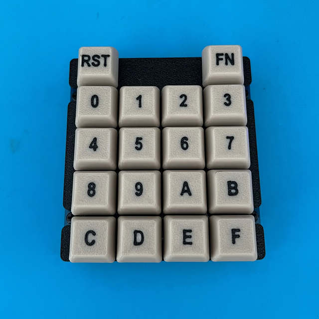

# Chippy

Chippy is a Rust implementation of the [CHIP-8](https://chip-8.github.io/links/) interpreter.

NOTE: Chippy uses the original [CHIP-8 instruction set](https://github.com/mattmikolay/chip-8/wiki/CHIP%E2%80%908-Instruction-Set). Games that use the [S-CHIP 1.1 specification](http://devernay.free.fr/hacks/chip8/schip.txt) may not work correctly.

No AI was used at any point in Chippy's development.

## Usage

Games are added to the `roms/` folder and referenced by filename. Filenames should include extensions.

Via `cargo run`:

```bash
$ cargo run ROM_FILENAME
```

Via binary:

```bash
$ cargo build
$ ./target/debug/rust-chip8 ROM_FILENAME
```

## Input

CHIP-8 was designed to run on computers with a hexadecimal keypad:



Chippy approximates this using the left side of the keyboard:

| Key        | Effect                      |
| ---------- | --------------------------- |
| 1, 2, 3, 4 | Hex keypad first row (0-3)  |
| Q, W, E, R | Hex keypad second row (4-7) |
| A, S, D, F | Hex keypad third row (8-B)  |
| Z, X, C, V | Hex keypad last row (C-F)   |

### Keyboard Shortcuts

| Key       | Effect                                    |
| --------- | ----------------------------------------- |
| Esc       | Quit program                              |
| Backspace | Reset                                     |
| \         | Show/hide debug panel                     |
| T         | Toggle step-by-step execution (step mode) |
| .         | Execute next cycle (step mode only)       |
| J         | Toggle CRT fade effect                    |
| 7, 8, 9   | CRT fade rate (slow/med/fast)             |
| P         | Cycle color palettes                      |

## Logging

Set the `RUST_LOG` env var to `debug` to see log messages in the console.

## Compatibility

The following is a list of games that have been tested with this interpreter:

| Game                  | Year  | Author            | Status | Notes                               |
| --------------------- | ----- | ----------------- | ------ | ----------------------------------- |
| 8CE Attorney - Disc 1 | 2016  | SystemLogoff      | ✅     | Haven't tested full game            |
| 8CE Attorney - Disc 2 | 2016  | SystemLogoff      | ✅     | Haven't tested full game            |
| 8CE Attorney - Disc 3 | 2016  | SystemLogoff      | ✅     | Haven't tested full game            |
| Br8kout               | 2014  | SharpenedSpoon    | ❌     | Stuck in draw loop                  |
| Breakout              | 1979  | Carmelo Cortez    | ✅     |                                     |
| Coin Flipping         | 1978  | Carmelo Cortez    | ✅     |                                     |
| Craps                 | 1978  | Carmelo Cortez    | ✅     |                                     |
| Flight Runner         | 2014  | TodPunk           | ❌     | Plays for a while then freezes      |
| Hi-Lo                 | 1978  | Jef Winsor        | ✅     |                                     |
| Kaleidoscope          | 1978  | Joseph Weisbecker | ❌     | Starts, but nothing else happens    |
| Lunar Lander          | 1979  | Udo Pernisz       | ✅     |                                     |
| Mastermind FourRow    | 1978  | Robert Lindley    | ✅     |                                     |
| Nim                   | 1978  | Carmelo Cortez    | ✅     |                                     |
| Outlaw                | 2014  | John Earnest      | ✅     |                                     |
| Pong                  | 1990  | Paul Vervalin     | ✅     |                                     |
| Pong (1-player)       | 1990? | Paul Vervalin?    | ✅     | Paul Vervalin's Pong w/CPU opponent |
| RPS                   | 2015  | SystemLogoff      | ❌     | Can't get past title screen         |
| Snek                  | 2021  | John Earnest      | ✅     |                                     |
| Tetris                | 1991  | Fran Dachille     | ✅     |                                     |

## Roadmap

- ~~CRT fade effect~~
- ~~Improve debugging~~
- Add SCHIP support
- Settings and flags visible in UI
- Move config to `settings.ini`
- Adjustable clock speed
- ROM hotswapping
- Add compiler/decompiler
- Alert text overlay with fadeout
- Simulated tape speed

## License

This software is released under the MIT license. See [`LICENSE.md`](./LICENSE.md) for the full text.
